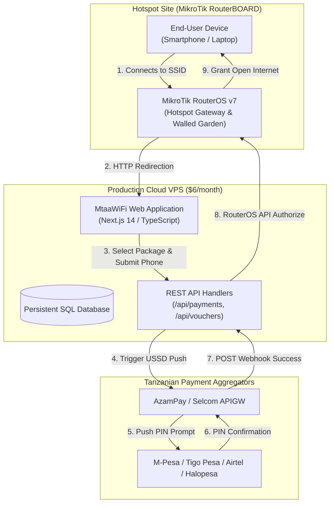

# 🇹🇿 Tanzania Public Wi-Fi Business & Operational Execution Manual
### Practical Field Guide: From Code to Profitable Commercial Deployment

---

## 1. Executive Summary & Market Viability

The public Wi-Fi market in Tanzania represents a high-yield telecommunications arbitrage opportunity. While mobile network operators (Vodacom, Tigo/Yas, Airtel, Halotel) have expanded 4G and 5G coverage, **retail data pricing remains prohibitively high** for students, micro-traders, and urban residents:

- Standard telco bundles average **2,000 TZS for a 1 GB to 1.5 GB daily bundle** (which is frequently depleted within hours or throttled under Fair Usage Policies).
- In contrast, a hotspot operator purchasing wholesale fiber at **150,000 to 250,000 TZS / month for a 50–100 Mbps uncapped pipe** can retail access at **500 TZS (1 hour)**, **1,000 TZS (3 hours)**, and **2,000 TZS (24 hours unlimited)**.
- With an average of **80 to 150 paying daily users per node**, a single outdoor hotspot generates **1.8M to 3.5M TZS in gross monthly revenue** against operational costs of under **500,000 TZS**.

---

## 2. Prime Location Selection & Footfall Analytics

A hotspot's profitability depends strictly on **density, dwell time (duration people stay seated or standing), and mobile data sensitivity**.

```
                           IDEAL SITE SELECTION MATRIX
       ┌──────────────────────────────┬──────────────────────────────┐
       │   HIGH DENSITY / HIGH DWELL  │    HIGH DENSITY / LOW DWELL  │
       │   ★ ★ ★ ★ ★ (TOP TIER)       │    ★ ★ ★ ☆ ☆ (SECONDARY)     │
       │                              │                              │
       │ • University Hostels/Campuses│ • Fast-Transit Daladala Stops│
       │ • Intercity Bus Terminals    │ • Petrol Stations            │
       │ • High-density Ghettos/Wards │ • Commuter Train Stations    │
       ├──────────────────────────────┼──────────────────────────────┤
       │   LOW DENSITY / HIGH DWELL   │    LOW DENSITY / LOW DWELL   │
       │   ★ ★ ☆ ☆ ☆ (NICHE ONLY)     │    ★ ☆ ☆ ☆ ☆ (AVOID)         │
       │                              │                              │
       │ • Boutique Cafes / Lounges   │ • Remote Highways            │
       │ • Private Hospitals/Offices  │ • Industrial Warehouses      │
       └──────────────────────────────┴──────────────────────────────┘
```

### High-Priority Target Zones in Tanzania:

1. **Higher Learning Hostels & Campuses:**
   - **Dar es Salaam:** UDSM (Mlimani Campus & Mabibo Hostels), Ardhi University, CBE (Bibi Titi), IFM (Posta), DIT, MUST.
   - **Dodoma:** UDOM (Social Science, Informatics, Humanities hostels).
   - **Mwanza:** SAUT (St. Augustine University), Bugando.
   - *Target Audience:* Students conducting academic research, downloading slide decks, watching YouTube tutorials, and gaming.

2. **Intercity & Regional Bus Terminals (Stendi za Mabasi):**
   - **Magufuli Bus Terminal (Mbezi Luis - Dar es Salaam)**, Stand ya Dodoma (Nanenane), Stand ya Arusha, Stand ya Nyegezi (Mwanza).
   - *Target Audience:* Transit passengers waiting 1 to 4 hours for scheduled departures; high social media and video consumption.

3. **High-Density Residential Hubs ("Uswahilini" / Neighborhood Estates):**
   - **Dar es Salaam:** Tandale, Manzese, Mabibo, Kimara Mwisho, Mwananyamala, Tegeta, Chanika.
   - *Target Audience:* Youth, freelancers, small business owners who lack fiber-to-the-home (FTTH) and rely on expensive mobile bundles.

4. **Commercial Marketplaces (Masoko):**
   - Kariakoo, Mwenge, Stereo Market (Temeke), Tandika.
   - *Target Audience:* Store clerks and street vendors streaming live sales on Instagram, TikTok, and WhatsApp Business.

---

## 3. Wholesale Bandwidth Sourcing (Upstream Backhaul)

To deliver fast, reliable service, secure an enterprise uncapped wholesale link:

| Provider | Access Technology | Typical Monthly Cost (TZS) | Suitability |
| :--- | :--- | :--- | :--- |
| **TTCL Fiber (Mkongo wa Taifa)** | Metro Fiber / DIA | 180,000 – 350,000 for 50–100 Mbps | **Best value** if site is near a TTCL fiber POP. Highly stable backhaul. |
| **Liquid Intelligent Technologies** *(formerly Raha)* | Metro Fiber / Wireless | 250,000 – 450,000 for 50–100 Mbps | Superb corporate uptime across Dar es Salaam, Arusha, and Mwanza. |
| **Zuku Fiber / SimbaNET** | SMB Business Fiber | 150,000 – 280,000 for 40–80 Mbps | Great entry-level package for small pilot installations. |
| **Airtel / Vodacom 5G Enterprise** | 5G Wireless Fixed Router | 170,000 – 300,000 for uncapped 5G | Ideal for rapid pilot testing where physical fiber trenching is delayed. |

> [!IMPORTANT]
> **Bandwidth Sizing Rule:** Hotspot users browse in intermittent bursts. Using MikroTik's **Per Connection Queue (PCQ)** and DNS caching, a **50 Mbps to 100 Mbps symmetrical link** easily supports **150 to 300 concurrent users** without degradation.

---

## 4. Hardware Bill of Materials (BOM) & Budget

### Single-Node Pilot Hardware Package (Covers 100m – 150m Outdoor Radius):

| Item | Model / Specification | Qty | Unit Cost (TZS) | Total Cost (TZS) | Purpose |
| :--- | :--- | :---: | :---: | :---: | :--- |
| **Core Gateway Router** | MikroTik `hAP ax3` or `RB5009UG+S+IN` | 1 | 320,000 | 320,000 | Hotspot NAT, DHCP, QoS queues, and Walled Garden enforcement. |
| **Outdoor Access Point** | Ubiquiti UniFi AC Mesh or TP-Link Omada EAP225-Outdoor | 1 | 240,000 | 240,000 | High-gain dual-band 2.4/5GHz Wi-Fi covering 80–120 concurrent devices. |
| **Power Backup (DC Mini-UPS)**| Marsriva or Gizzu Mini DC UPS (PoE 24V/12V) | 1 | 90,000 | 90,000 | **Mitigates TANESCO load-shedding.** Runs router and AP for 4–6 hours during outages. |
| **Ethernet Cabling** | Cat6 Outdoor FTP/STP Shielded Cable (30m) | 1 | 60,000 | 60,000 | UV-resistant outdoor cable with grounding drain wire. |
| **Mounting Hardware** | Galvanized Steel Pipe (3m) + Clamps + Enclosure Box | 1 | 75,000 | 75,000 | Waterproof rooftop/mast mounting for outdoor hardware. |
| **Surge Protector** | Ubiquiti ETH-SP-G2 Gigabit Surge Protector | 1 | 45,000 | 45,000 | Protects indoor electronics from outdoor static and lightning. |
| **Initial Printed Vouchers** | 58mm Thermal Paper Rolls (Pack of 10) | 1 | 15,000 | 15,000 | Initial stock of scratch-card style paper tickets for kiosk agents. |
| **ESTIMATED TOTAL CAPEX** | | | | **845,000 TZS** | **Complete turnkey hardware deployment for 1 site.** |

---

## 5. Power Resilience Strategy (TANESCO Engineering)

> [!WARNING]
> TANESCO power outages and voltage spikes will destroy your customer trust and hardware if unaddressed. Uninterrupted power is the single biggest competitive advantage in Tanzania.

### A. Level 1: Single Node (Hostel / Shop Rooftop)
- Connect a **Marsriva KP3 / KP7 Mini DC UPS** directly to the MikroTik router (12V DC) and UniFi AP (24V PoE).
- During TANESCO blackouts, switching is instantaneous (0 ms delay); clients do not drop Wi-Fi connections.
- Provides **4 to 6 hours** of continuous battery life.

### B. Level 2: Central Tower / High-Site Node
- 1x **150W Solar Panel** (Mono-crystalline).
- 1x **20A MPPT Solar Charge Controller**.
- 1x **100Ah 12V LiFePO4 (Lithium) or Deep Cycle Gel Battery**.
- Guarantees **24/7/365 uninterrupted uptime** completely immune to the municipal grid.

---

## 6. Software Architecture & Production Cloud Deployment



### Production Hosting Instructions:
1. **Cloud Server:** Provision an Ubuntu 24.04 VPS on DigitalOcean, Hetzner, or AWS Lightsail (**$5 – $10 / month**).
2. **Domain & SSL:** Point `login.mtaawifi.tz` to the VPS IP and provision a free Let's Encrypt SSL certificate using Certbot or Caddy.
3. **Environment Setup:** Set environment variables in `.env.production`:
   ```env
   NODE_ENV="production"
   NEXT_PUBLIC_APP_URL="https://login.mtaawifi.tz"
   PAYMENT_GATEWAY_PROVIDER="azampay"
   AZAMPAY_ENV="production"
   MIKROTIK_HOST="your-site-static-ip"
   MIKROTIK_USER="api_billing"
   MIKROTIK_PASSWORD="strong_random_password"
   ```
4. **MikroTik Hotspot Configuration:** Set the MikroTik Hotspot login page to redirect unauthorized browsers to `https://login.mtaawifi.tz`.

---

## 7. Regulatory Compliance & Legal Licensing (TCRA & TRA)

Operating public internet access in Tanzania requires adhering to telecommunications and revenue regulations:

### A. TCRA (Tanzania Communications Regulatory Authority)
1. **Reseller Authorization:** Rather than acquiring a multi-million shilling national Network Facilities License, small hotspot businesses operate under a **Value-Added Service (VAS) / Reseller Class License** through an authorized Tier-1 or Tier-2 provider (TTCL, Liquid, Zuku).
2. **Cybercrimes Act (2015) & EPOCA:**
   - Operators are legally mandated to retain session accounting records (IP address assignment, MAC address, subscriber phone number, and timestamp).
   - Use our built-in **`GET /api/admin/tcra-export`** tool to archive quarterly compliance logs for lawful audits.

### B. TRA & Municipal Registration
1. **BRELA Business Registration:** Register a Business Name (e.g., *MtaaWiFi Services*) or Private Limited Company.
2. **TRA Tax Clearance:** Obtain a Tax Identification Number (TIN).
3. **Municipal Business Permit (*Leseni ya Biashara*):** Procured from your local Municipal Council (Manispaa ya Ilala, Kinondoni, Ubungo, Dodoma, etc.).

---

## 8. Physical Voucher Distribution: The "Duka la Mangi" Model

While mobile money USSD push is seamless, **over 40% of Tanzanian street consumers prefer purchasing physical vouchers with pocket cash**.

### The Agent Kiosk Strategy:
```
[You: Hotspot Operator] 
       │
       │ Sells 1,000 TZS tickets in bulk at 10% discount (850 - 900 TZS each)
       ▼
[Kiosk Agent: Duka la Mangi / Stationery / Kibanda]
       │
       │ Sells tickets to customers at full face value (1,000 TZS cash)
       │ Earns 100 - 150 TZS risk-free profit per voucher
       ▼
[End User: Subscriber]
```

1. **Print Vouchers:** Use the system's **`/admin/vouchers/print`** interface with a 58mm or 80mm thermal receipt printer (or print 24-ticket grids on A4 paper and cut with scissors).
2. **Onboard Retailers:** Partner with stationery shops, duka la mangi, chips kiosks, and mama ntilie located within your AP signal radius.
3. **Zero Resistance:** Kiosk owners have zero inventory risk and actively market your Wi-Fi to customers hanging around their shop.

---

## 9. Unit Economics & Monthly Profit Projection (1 Site)

### A. Conservative Projections (1 Node - 100 active users/day):

| Revenue Stream | Quantity | Price (TZS) | Monthly Total (TZS) |
| :--- | :---: | :---: | :--- |
| **1-Hour Passes (500 TZS)** | 40 / day | 500 | 600,000 |
| **3-Hour Passes (1,000 TZS)** | 45 / day | 1,000 | 1,350,000 |
| **24-Hour Passes (2,000 TZS)** | 15 / day | 2,000 | 900,000 |
| **Weekly Passes (7,000 TZS)** | 5 / week | 7,000 | 140,000 |
| **GROSS MONTHLY REVENUE** | | | **2,990,000 TZS** |

### B. Monthly Operating Expenses (OPEX):

| Expense Item | Cost (TZS) | Notes |
| :--- | :---: | :--- |
| **Wholesale Fiber Link (50–100 Mbps)** | 250,000 | TTCL / Liquid Intelligent Technologies |
| **Rooftop / Power Rent to Host** | 50,000 | Paid to building owner for power & roof space |
| **Cloud VPS Server & Domain** | 25,000 | Next.js server hosting & database |
| **Payment Gateway Fees (AzamPay 2%)** | 60,000 | Telco processing fees |
| **Agent Commissions (10% on vouchers)** | 100,000 | Paid to local kiosks |
| **Maintenance & Incidentals** | 50,000 | Spares & transport |
| **TOTAL MONTHLY OPEX** | **535,000 TZS** | |

### C. Net Monthly Profit (Per Node):
$$\text{Net Monthly Profit} = 2,990,000 - 535,000 = \mathbf{2,455,000\text{ TZS / month}}$$

> [!TIP]
> **Payback Period:** With initial CAPEX of approximately **845,000 TZS**, the initial capital investment is **fully recouped within the first 15 to 25 days** of commercial operation.

---

## 10. 30-Day Step-by-Step Pilot Launch Runbook

```
WEEK 1: Lab Procurement & Setup
├── Day 1-2: Purchase MikroTik router (hAP ax3) and Ubiquiti UniFi Outdoor AP.
├── Day 3-4: Deploy Next.js web application on Cloud VPS with SSL domain.
└── Day 5-7: Benchmark RouterOS API user provisioning and AzamPay sandbox USSD push.

WEEK 2: Site Survey, Mounting & Backhaul
├── Day 8-10: Sign rooftop/power agreement with host building owner (50,000 TZS/mo).
├── Day 11-12: Mount outdoor AP at 4m–6m height with shielded Cat6 cable.
└── Day 13-14: Connect DC Mini-UPS backup and terminate wholesale fiber/5G link.

WEEK 3: Promotion & Network Optimization
├── Day 15-18: Broadcast open SSID: "MtaaWiFi_Free_Majaribio" (15 min free pass).
├── Day 19-21: Analyze PCQ queue performance with 100+ concurrent devices.
└── Day 22: Adjust AP power channels (20MHz on 2.4GHz, 40/80MHz on 5GHz) to eliminate interference.

WEEK 4: Commercial Monetization
├── Day 23: Switch captive portal to live billing mode.
├── Day 24: Distribute 100 printed thermal tickets to 3 local kiosks.
├── Day 25-28: Monitor mobile money incoming webhooks and real-time TZS revenue on /admin.
└── Day 29-30: Calculate pilot net profit and identify location for Node #2.
```
